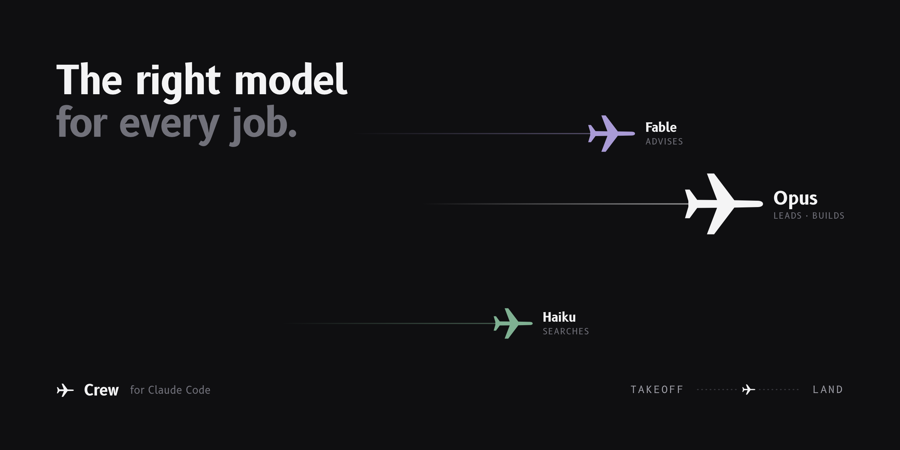

# Crew

**A Claude Code plugin that gives each kind of job the right Claude model, so your weekly usage lasts the week.**

| Job                                      | Model                                   |
| ---------------------------------------- | --------------------------------------- |
| Everyday work: building, planning, fixing | Opus 5.5 at **medium** effort           |
| Searching files, reading long logs       | Haiku 5.5 helpers                       |
| A second opinion when a job is stuck     | Fable 5.2 as the **advisor**, only on named triggers |

The rules follow Anthropic's own advice: keep the main chat on one strong model, hand searching and log reading
to a small model, let simple code pick the model rather than another model, and switch only at a natural break.

> **Status: an experiment.** I'm running it on my own week now and will post the numbers. Feedback welcome.

## What it does

- **Off until you say so.** Installing changes nothing. `/crew takeoff` switches it on, `/crew land` puts back
  exactly what takeoff changed.
- **Touches three settings only** in `~/.claude/settings.json`: `model`, `advisorModel` and Opus's effort level.
  It writes a receipt *before* changing anything, so land can undo it precisely. If you change one of those
  settings by hand while crew is on, land leaves your change alone and tells you.
- **Adds a Haiku search helper** (`~/.claude/agents/Explore.md`, marked "made by crew"; land deletes it) and a
  read-only `log-reader` helper.
- **Rules for the advisor.** Claude calls it only when the same fix failed twice, you corrected it twice, you type
  `/crew boost`, or once before a big multi-file job, and says in one line why. Never as a routine check.
- **Never switches models by itself.** When a job stays stuck, `/crew boost` suggests a fresh chat on Fable; you
  decide.
- **Shows where your week goes.** `/crew pace` gives one line on how your week compares with a normal week by this
  day. `/crew log` opens a page with a bar per day, split by model, plus dots for advisor calls, boosts and handoffs.
  It reads your saved chats on your own machine and makes no AI calls.

## Install

In Claude Code:

```text
/plugin marketplace add petertrawka/claude-crew
/plugin install crew@crew
```

Start a new chat, then:

```text
/crew takeoff
```

…and start one more new chat (open chats keep their old model and effort).

**Your weekly reset.** `/crew pace` assumes the usage week resets on Thursday at 03:00 local time. If yours is
different, add this to the `env` block of `~/.claude/settings.json` (three-letter day + hour, 24-hour clock):

```json
"env": { "CREW_WEEK_START": "mon09" }
```

## Commands

```text
/crew takeoff    switch on (then start a new chat)
/crew land       switch off and put everything back (then start a new chat)
/crew            is it on? what are my settings?
/crew boost      this job is stuck: ask the advisor
/crew pace       how is my week going?
/crew log        the flight log page
/crew keep DIR   also save landing reports and the flight log in DIR
```

## Remove it

Land first, then remove:

```text
/crew land
/plugin marketplace remove crew
```

## Undo by hand

If crew is ever uninstalled while still on, `/crew takeoff` printed the old values. Put them back in
`~/.claude/settings.json`: `model`, `advisorModel` and `modelSettings` → `claude-opus-5-5` → `effortLevel`.
Then delete `~/.claude/agents/Explore.md` if its second line says "made by crew".

## Requirements

- Claude Code with access to Opus 5.5, Haiku 5.5 and Fable 5.2 (Fable as advisor)
- Python 3 (standard library only)
- macOS or Linux (`/crew log` opens the page with macOS `open`; Windows is untested)

## Tests

```text
python3 -m pytest -q tests
```

## Licence

MIT
